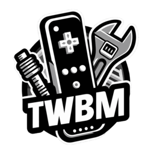
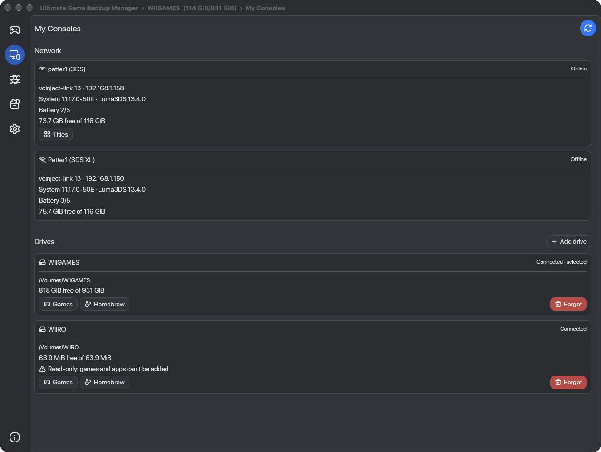

### `TinyWiiBackupManager` :star: A tiny game backup and homebrew app manager for the Wii

 

> [!CAUTION]
> TinyWiiBackupManager is intended strictly for legal homebrew use and is not affiliated with or endorsed by Nintendo.
> Use of TinyWiiBackupManager for pirated or unauthorized copies of games is strictly prohibited.

## :sparkles: Features

- **Lightweight & Fast**: Native app written in Rust and Iced, no Electron!
- **Cross-Platform**:
  - :window: Windows XP+ | x86 (32-bit), x64 (64-bit), arm64 (Qualcomm Snapdragon etc.)
  - :apple: macOS 10.12+ | x86_64 (Intel), arm64 (Apple Silicon/M1+)
  - :penguin: Linux ~2020+ | x86 (32-bit), x86_64 (64-bit), arm64 (Raspberry PIs etc.)

#### :video_game: Game Management

- **Games view**: Manage your Wii and GameCube games
- **Fast transfer**: An optional shared setting for imports and exports, available in Settings, the import queue, batch export, and game details. It uses extra memory and may improve speed depending on the drive, while keeping the chosen format and game data unchanged. It is off by default and does not change the number of simultaneous games.
- **Batch and parallel import**: Add game files or a folder, select individual games or **Select all** in the import queue, and choose **Import selected**. Choose 1–4 **Simultaneous games** (2 by default); 1 imports sequentially. Each batch uses the destination and settings captured when it starts. Newly added games wait for the next batch, and failed games remain in the queue for retry.
- **Cancel import**: Use **Cancel import** in the import queue or its progress notification, including after navigating to another page. Cancellation stops new jobs and waits for running work and temporary-file cleanup. Completed games stay on the drive; cancelled and pending entries remain selected for retry. A current disk operation or compression block may need to finish first.
- **Parallel export**: Use the Games toolbar's **Export games** button to select individual games or **Select all**, choose an output format, and export to one folder. Choose 1–4 **Simultaneous games** (2 by default); more jobs may be slower on a USB drive. Each export writes to its own temporary file before publishing the completed result. Existing files are kept; failures are reported without stopping the remaining exports.
- **Individual export**: On Windows, choose RVZ, ISO, WBFS, CISO, GCZ or WIA from **Save as type** when exporting a single game. The filename extension follows the selected format.
- **Cancel export**: Cancel a single, sequential or parallel export from its progress notification. Cancellation stops new jobs and waits for running work and temporary-file cleanup before allowing another export. Completed files are kept; unfinished files are removed. A current disk operation or compression block may need to finish first.
- **Format Support**: .iso, .rvz and major formats thanks to [NOD](https://github.com/encounter/nod)
- **Automatic Splitting**: .wbfs file splitting when needed
- **Partition Stripping**: Remove the update partition to save space
- **Game Archiving**: Archive games using RVZ+zstd-19
- **Integrity Checks**: Use **Check SHA1** in the Games toolbar to select individual games or **Select all** and compare their disc hashes with the bundled Redump database. Results stay available after closing the window; an unknown hash does not necessarily mean corruption.
- **GameTDB**: Fetch covers and `wiitdb.xml` from GameTDB
- **TxtCodes**: Download cheat codes from geckocodes.org (web archive), codes.rc24.xyz and gamehacking.org

#### :toolbox: Wii Homebrew Management

- **Apps view**: Manage Wii homebrew applications
- **OSC view**: Download apps from the Open Shop Channel
- **Wiiload**: Send apps directly to Wii via network

 

## :arrow_down: Downloads

<table>
  <tr>
    <td width="9999px"><strong>:window: Windows</strong></td>
  </tr>
  <tr>
    <td>
      :arrow_right: <a href="https://github.com/mq1/TinyWiiBackupManager/releases/latest">Download standalone binary</a>
       
       
      :package: <code>winget install -e --id mq1.TinyWiiBackupManager</code>
    </td>
  </tr>
</table>

<table>
  <tr>
    <td width="9999px"><strong>:apple: macOS</strong></td>
  </tr>
  <tr>
    <td>
      :arrow_right: <a href="https://github.com/mq1/TinyWiiBackupManager/releases/latest">Download universal DMG</a>
    </td>
  </tr>
</table>

<table>
  <tr>
    <td width="9999px"><strong>:penguin: Linux</strong></td>
  </tr>
  <tr>
    <td>
      :arrow_right: <a href="https://flathub.org/apps/it.mq1.TinyWiiBackupManager">Download on Flathub</a> (recommended for most users)
       
      :arrow_right: <a href="https://github.com/mq1/TinyWiiBackupManager/releases/latest">Download AppImage</a>
    </td>
  </tr>
</table>

 

## :page_facing_up: Additional Info

For useful tips, check out the [Wiki](https://github.com/mq1/TinyWiiBackupManager/wiki)

 
 

 Made with :white_heart::pink_heart::light_blue_heart::brown_heart::black_heart::heart::orange_heart::yellow_heart::green_heart::blue_heart::purple_heart: for the Wii homebrew community 

